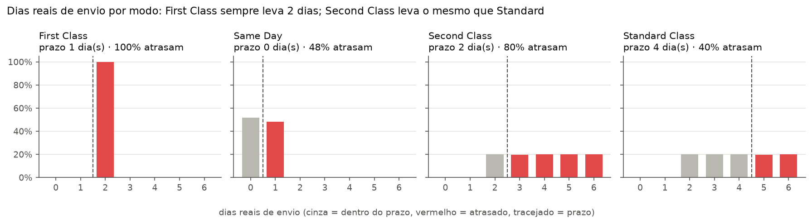
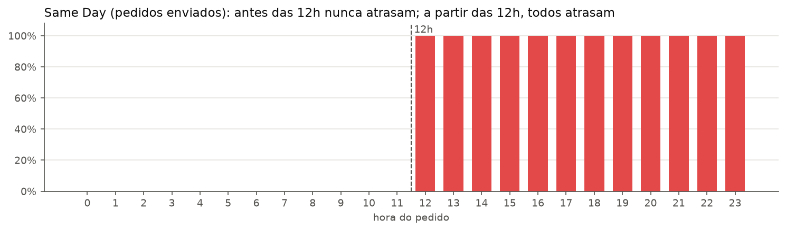
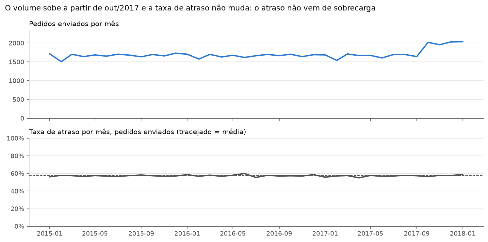
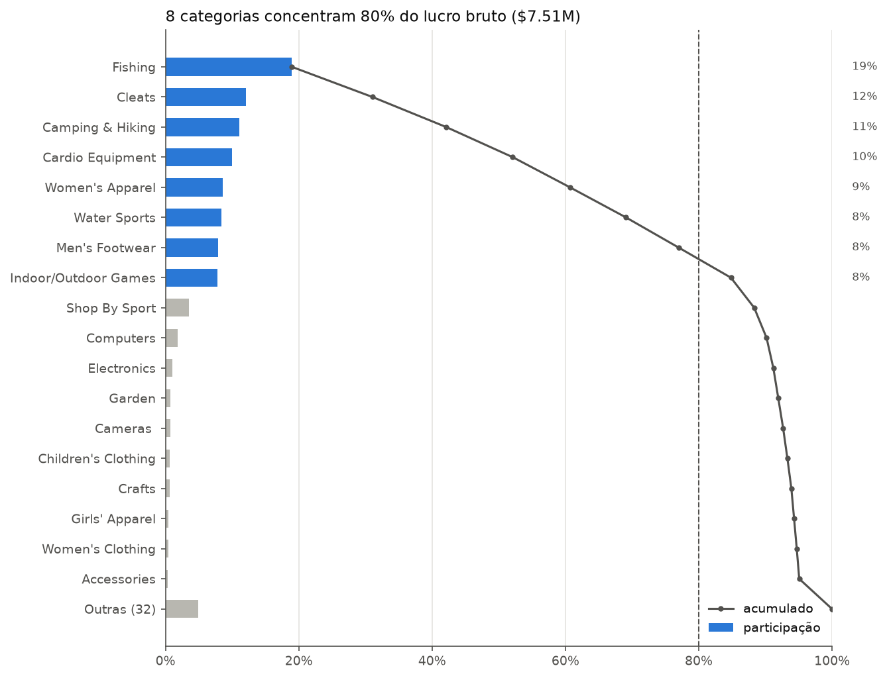
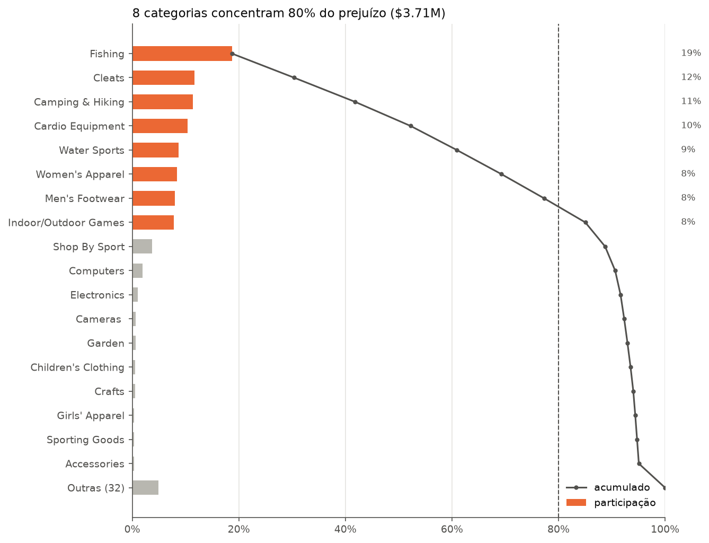
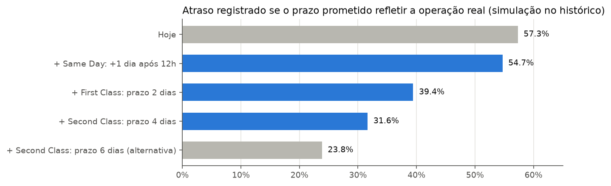

# Análise DataCo Supply Chain: atrasos e lucratividade

**Resumo.** 57% dos pedidos enviados atrasam porque os prazos prometidos para First Class, Second Class e Same Day estão abaixo do tempo real da operação. Alinhar a promessa à operação reduz o atraso registrado de 57,3% para 31,6%, mas não deixa nenhuma entrega mais rápida. Sem pedidos cancelados e suspeitos de fraude, a operação fecha com lucro líquido de $3,81M, margem de 12,0%.

**Dados:** CSV original do [Kaggle](https://www.kaggle.com/datasets/shashwatwork/dataco-smart-supply-chain-for-big-data-analysis), com 180.519 itens em 65.752 pedidos, de jan/2015 a jan/2018. O dataset é sintético.

**Base das taxas de atraso:** os 62.897 pedidos enviados. Os 2.855 pedidos `CANCELED` e `SUSPECTED_FRAUD` nunca saem, então não podem atrasar nem chegar no prazo, e ficam fora do cálculo. Contá-los como "não atrasados" baixaria a taxa para 54,8%.

## 1. O atraso vem do prazo prometido, não da operação

Cada modo de envio tem um tempo real de entrega fixo ou previsível. O prazo prometido ao cliente é que está abaixo dele.

| Modo | Prazo atual | Dias reais | Pedidos atrasados |
| --- | --- | --- | --- |
| First Class | 1 dia | sempre 2 | 100% |
| Second Class | 2 dias | 2 a 6 (média 4) | 80% |
| Same Day | 0 dia | 0 ou 1 | 48% |
| Standard Class | 4 dias | 2 a 6 (média 4) | 40% |

- O First Class nunca cumpre o prazo, porque leva sempre exatamente 2 dias.
- O Second Class tem o mesmo tempo real do Standard Class. Hoje ele não entrega mais rápido.

### Same Day: o horário do pedido decide o atraso

Pedidos Same Day feitos antes das 12h saem no mesmo dia. Os feitos a partir das 12h saem no dia seguinte e são todos registrados como atraso. Existe um horário de corte ao meio-dia que não é comunicado ao cliente.

### O que não explica o atraso

- **Distância e destino:** a taxa de atraso fica entre 56,5% e 57,7% em todos os mercados (África, Europa, LATAM, Ásia-Pacífico, EUA/Canadá).
- **Categoria e produto:** nas categorias com pelo menos 100 itens, a taxa fica entre 49% e 63%, sem relação com o tipo de produto.
- **Dia da semana:** nos modos First, Second e Standard Class, a variação é menor que 2 pontos.
- **Volume:** os pedidos sobem cerca de 20% a partir de out/2017, e a taxa de atraso não muda.

**Mudança no dataset a partir de out/2017.** O número de pedidos sobe, mas cada pedido passa a ter 1 item em vez de 3, de um catálogo diferente (31 produtos, contra 100 antes). O faturamento por pedido cai de $596 (set/2017) para $140 (jan/2018). Por isso a linha de faturamento cai no fim da série enquanto a de pedidos sobe. Não é mês incompleto: os dados vão até 31/jan/2018. É uma quebra do dataset sintético, e comparações de faturamento entre os dois períodos não são válidas.

## 2. Probabilidade de atraso

Uma árvore de decisão rasa (`src/dataco/model.py`) usa só o que se sabe no momento do pedido. Ela chega a 5 regras:

| Regra | P(atraso) prevista | Taxa real no teste |
| --- | --- | --- |
| First Class | 100% | 100% |
| Same Day, pedido a partir das 12h | 100% | 100% |
| Second Class | 79,8% | 80,5% |
| Standard Class | 39,9% | 39,5% |
| Same Day, pedido antes das 12h | 0% | 0% |

- **Validação:** treino com pedidos até jun/2017 e teste no período seguinte. O AUC é 0,777 no teste e 0,774 no treino, sem sinal de overfit.
- **Estabilidade:** em quatro cortes de tempo diferentes, o AUC ficou entre 0,767 e 0,777.
- **Variáveis sem efeito:** tipo de pagamento, mercado, segmento e dia da semana não entraram na árvore.

## 3. Lucro e prejuízo

Os valores abaixo excluem os pedidos `CANCELED` e `SUSPECTED_FRAUD`. Eles nunca são enviados, mas o dataset registra para eles $1,41M de receita e $160K de benefit. O dashboard segue a mesma regra.

| Indicador | Valor |
| --- | --- |
| Receita | $31,64M |
| Lucro bruto (itens com benefit positivo) | $7,51M |
| Prejuízo (itens com benefit negativo) | −$3,71M |
| Resultado líquido | $3,81M (12,0%) |

- 81% dos itens dão lucro e 19% dão prejuízo. A proporção é a mesma em todas as categorias, produtos, mercados, faixas de desconto e modos de envio.
- O prejuízo é concentrado: os itens que perdem mais do que o próprio valor de venda são 18,6% dos itens negativos e respondem por 53% do prejuízo.

As mesmas 8 categorias concentram 80% do lucro e 80% do prejuízo, ou seja, o prejuízo acompanha o volume vendido.

## 4. Próximas ações

As ações 1 a 3 mudam a promessa, não a entrega. O prazo passa a refletir a operação real: o cliente recebe no mesmo tempo de hoje, mas a promessa fica honesta. A queda do atraso no gráfico acima mede o alinhamento entre promessa e operação, não uma entrega mais rápida. Para entregar mais rápido de fato, é preciso mudar a operação.

1. **Same Day:** para pedidos feitos a partir das 12h, prometer o dia seguinte e comunicar esse horário de corte ao cliente. Hoje esses pedidos já saem no dia seguinte. No histórico, todos os pedidos Same Day passariam a chegar dentro do prometido.
2. **First Class:** prometer 2 dias em vez de 1, que é o tempo que a operação sempre leva. Todos os pedidos passariam a chegar dentro do prometido.
3. **Second Class:** prometer 4 dias em vez de 2. Ainda assim, 40% dos pedidos chegariam depois do prometido. Prometer 6 dias cobre todos, mas iguala o Second Class ao Standard.
4. **Trade-off a decidir antes das ações 2 e 3:** First e Second Class são modos premium, e o prazo curto é o que justifica o preço. Aumentar o prazo enfraquece esse valor. A alternativa é investir na operação para cumprir os prazos atuais. Isso vale principalmente para o Second Class, que hoje leva o mesmo tempo que o Standard.
5. **Relatórios de resultado:** manter os pedidos `CANCELED` e `SUSPECTED_FRAUD` fora do faturamento e do lucro, como já fazem este relatório e o dashboard.
6. **Monitoramento:** acompanhar no Power BI (`bi/`) a taxa de atraso por modo e por faixa de horário depois de qualquer mudança de prazo ou de operação.

---

Para reproduzir: `cd src && ../.venv/bin/python -m dataco.figures` gera os gráficos em `docs/figures/`. Os notebooks `notebooks/02_eda.ipynb` e `notebooks/03_modelo_atraso.ipynb` trazem as análises completas.
